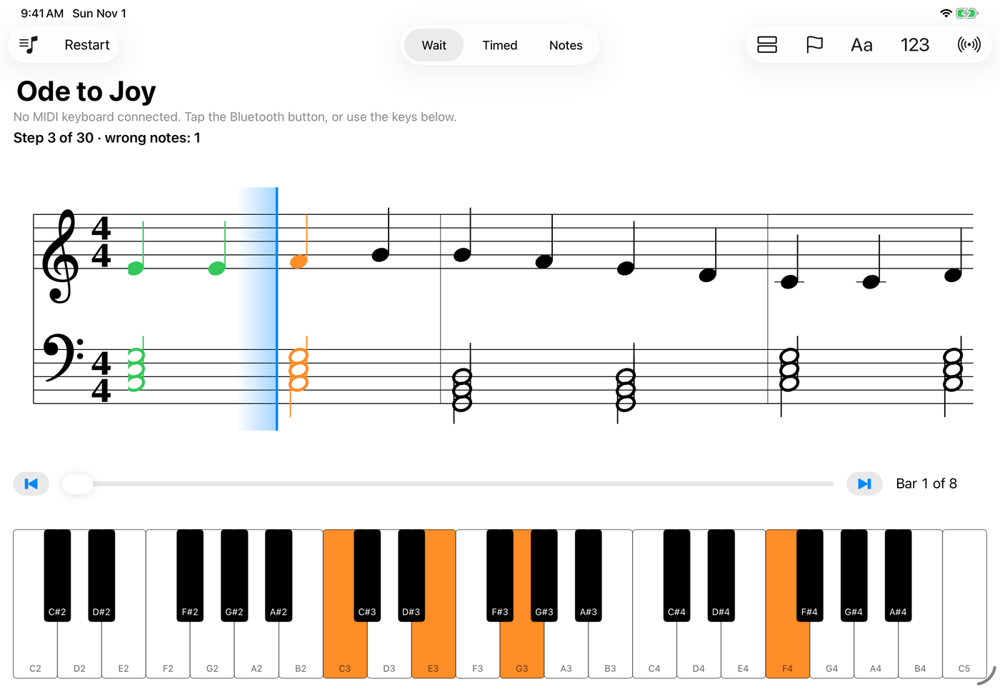
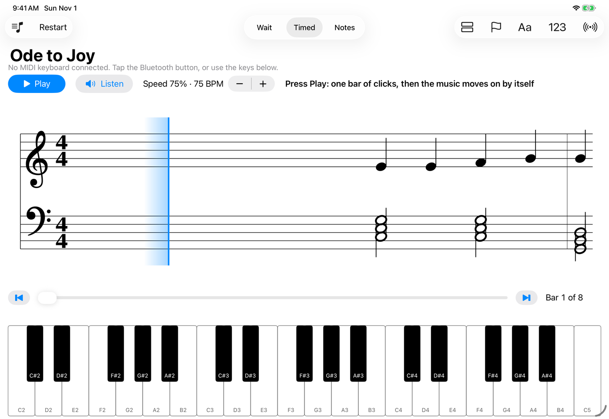
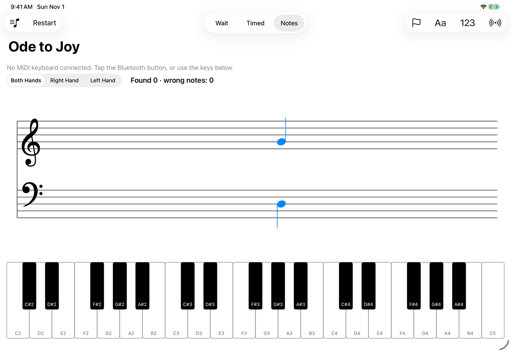
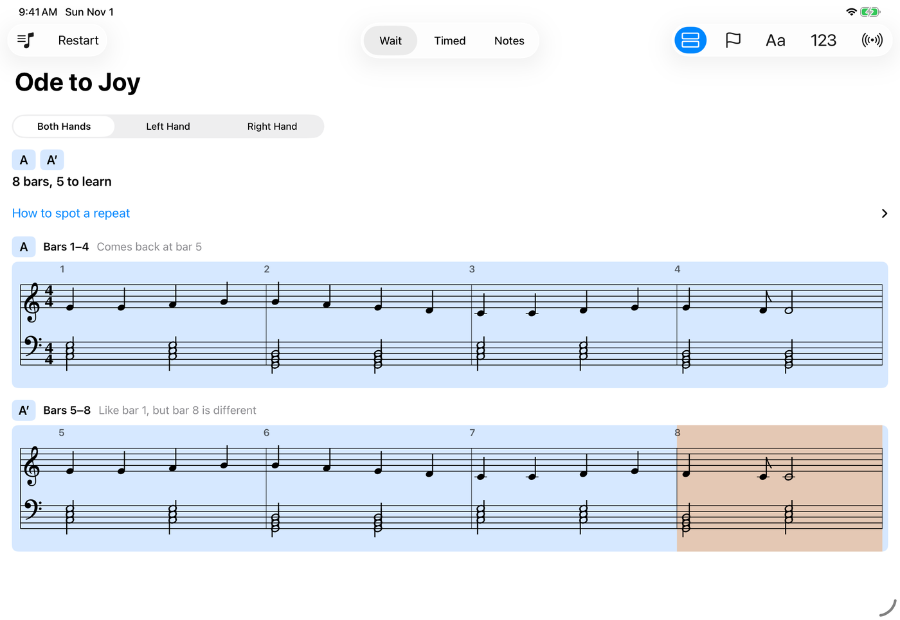
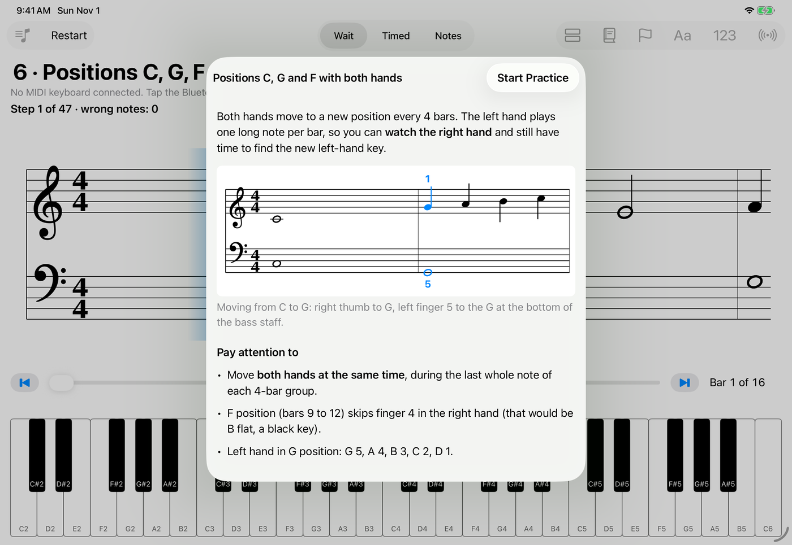
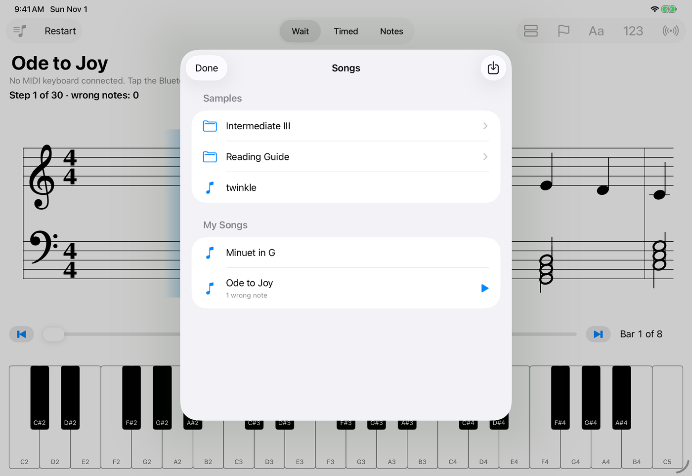

# PianoGuide

An iPad app that guides piano practice. It loads a song from a MIDI file, listens to your keyboard over MIDI,
and shows the notes on a scrolling grand staff, marking what you got right and what you still need to play.
It was built for a Roland FP-30X, and is meant to work with other MIDI keyboards too. With no keyboard connected,
you can tap the on-screen keys instead.

This is a personal project and is not planned for the App Store. See [Project status](#project-status) for what has been tested.



## Features

- **Wait mode:** the song waits until you play the right note or chord. Keys turn green when correct and red when
  wrong, and after a wrong note the keys you still need turn orange. Tap a clef to practise one hand.
- **Timed mode:** the music moves on at a speed you choose, after one bar of metronome clicks, and the app counts the
  notes you played, missed and got wrong. **Listen** plays the song by itself at that speed.
- **Notes mode:** a drill that asks for random notes from the song, one hand or both, and asks the ones you miss more often.
- **Song overview:** the whole piece in small staves, with repeated sections marked so you know how much there really is to learn.
- **Song library:** bundled practice pieces with lesson notes, plus your own `.mid` files imported from the Files app.
  Finished songs get a check mark, songs with many recent wrong notes are flagged as difficult, and you can mark songs yourself.
- **Reading help:** note names on the keys and finger numbers on the staff (each can be turned off), and bar controls to jump around the song.

## Screenshots

| Timed mode | Notes mode |
| --- | --- |
|  |  |

| Song overview | Lesson note |
| --- | --- |
|  |  |

| Song library |
| --- |
|  |

## Getting started

You need a Mac with Xcode and [XcodeGen](https://github.com/yonaskolb/XcodeGen) (`brew install xcodegen`). The app targets iPadOS 17 or later.

```sh
xcodegen generate          # creates PianoGuide.xcodeproj from project.yml
open PianoGuide.xcodeproj  # choose an iPad simulator or your iPad, then press Run
```

To try it with songs of your own, use **Songs → Import**; [TestSongs/](TestSongs/) has two to start with.
The simulator can't see MIDI keyboards, so to play a real piano from the Mac, run the Mac Catalyst build.
[docs/DEVELOPMENT.md](docs/DEVELOPMENT.md) covers that, installing on an iPad, and pairing over Bluetooth.

Run the core logic tests with:

```sh
scripts/check-core.sh      # runs swift test in Packages/PianoCore
```

## Project status

Work in progress. The app runs in the iPad simulator, and has been played with an FP-30X over USB in the Mac Catalyst build.
**Bluetooth pairing and running on a real iPad are not verified yet.** MIDI is the only import format for now (MusicXML is planned), and the staff
doesn't draw rests, beams, dots or flats yet.

- [PLAN.md](PLAN.md): goals, architecture and milestones
- [docs/STATUS.md](docs/STATUS.md): current progress, next steps and known issues
- [docs/DEVELOPMENT.md](docs/DEVELOPMENT.md): environment, build, test and install

## How the code is organized

- `Packages/PianoCore`: the music logic, with no UI code: song model, MIDI parser and writer, practice engines, staff layout
- `App/Sources`: the SwiftUI screens and CoreMIDI input
- `App/Resources/SampleSongs`: the bundled songs and their lesson notes
